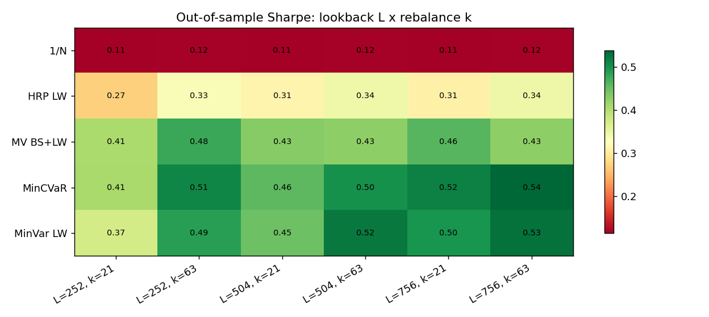
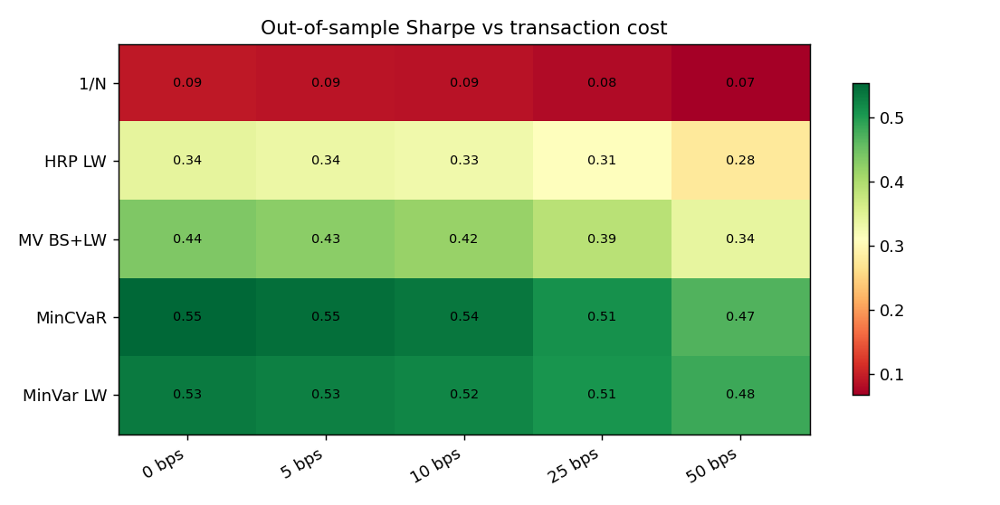
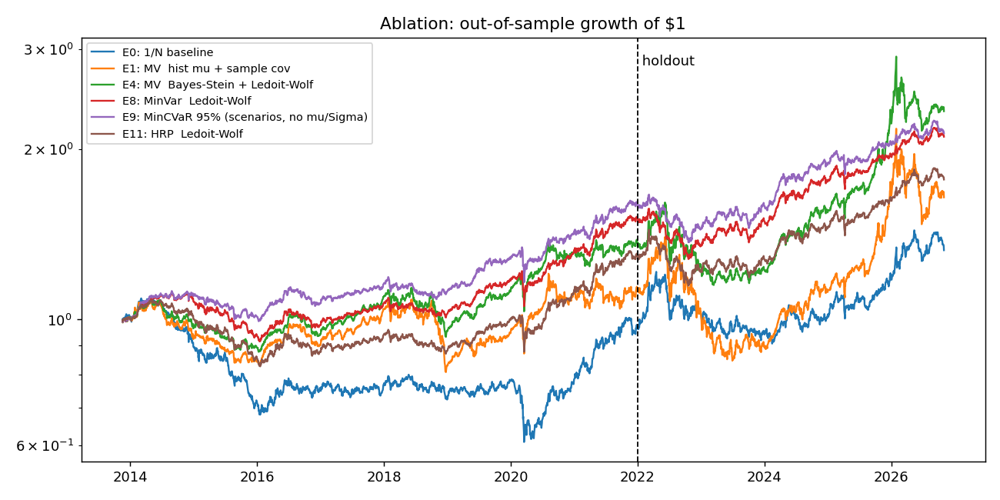

# Quant Portfolio Lab

A portfolio construction and risk system for multi-asset portfolios. Given a universe of tickers, capital and a risk appetite, it

1. estimates expected returns and covariance with **shrinkage estimators**,
2. builds a portfolio with one of **10 optimisers** (Markowitz, max-Sharpe, risk parity, HRP, Black-Litterman, min-CVaR, ...),
3. measures **ex-ante risk** (Euler risk contributions, VaR/CVaR under three models, concentration),
4. evaluates every rule **out-of-sample** with a walk-forward backtest including transaction costs, and tests whether
   the Sharpe ratios are **statistically** different from the naive 1/N portfolio,
5. runs **Monte Carlo** (block bootstrap / Gaussian / Student-t) and **stress tests** (historical crises + beta shocks),
6. produces a **trade list** to move an existing account to the target, and a written brief.

> Educational/research tool, not investment advice.


| | reference | this project |
|---|---|---|
| Optimisers | HRP, mean-variance, Black-Litterman | + max Sharpe, min variance, ERC risk parity, max diversification, min-CVaR (LP), inverse vol, 1/N |
| Return estimator | sample mean | Bayes-Stein shrinkage (Jorion 1986), EWMA, sample |
| Covariance | Ledoit-Wolf | Ledoit-Wolf, EWMA (RiskMetrics), sample, with PSD repair |
| **Out-of-sample backtest** | none | walk-forward, no look-ahead, weight drift, transaction costs, turnover |
| **Statistical inference** | none | PSR, Jobson-Korkie-Memmel vs 1/N, Holm-Bonferroni, block-bootstrap Sharpe CIs, Deflated Sharpe Ratio |
| VaR / CVaR | historical 95% | historical, Gaussian, Cornish-Fisher; 95% and 99% |
| Monte Carlo | none | block bootstrap, Gaussian, Student-t, same drift/rebalance/cost process as the backtest |
| Stress tests | none | 5 historical crises replayed + beta-based market shocks |
| Risk-free rate | constant | live 13-week T-bill (^IRX) time series |
| Explanation | LLM text (can make up numbers) | rule-based brief: every sentence comes from a computed number |
| Data backup | synthetic prices only | bundled 94-ticker real-price snapshot + offline mode; synthetic only as last resort |
| Experimental design | none | estimator ablation, holdout period, sensitivity heatmaps (`run_experiments.py`) |
| Tests | smoke tests | 35 tests against closed-form results (see below) |

## QuantFolio web app

```bash
python server.py            # then open http://127.0.0.1:8000
```

A web workstation over the same engine: no build step, works offline with the bundled snapshot (Plotly is served from the
local Python package). Views: Overview, Asset Universe, Optimisation, Strategies, Backtesting, Risk Analytics, Monte Carlo
and Experiments, plus a landing page. Every number comes from these endpoints in `server.py`:

| endpoint | engine call |
|---|---|
| `GET /api/meta` | method lists, risk profiles, snapshot manifest |
| `POST /api/universe` | `prepare_prices` → per-asset stats, rebased prices, correlation |
| `POST /api/analyze` | `run_pipeline` (allocation, ex-ante risk, frontier, stress, trades, Monte Carlo, optional walk-forward backtest with Holm/DSR stats) |
| `POST /api/montecarlo` | `simulate_paths` with the current weights (bootstrap / Student-t / Gaussian, drift + rebalancing + costs) |
| `GET /api/experiments` | reads `results/experiments/*.csv` |

Each card is tagged by provenance: *Historical*, *Backtest · out-of-sample*, *Ex-ante estimate*, *Simulated* or
*Saved experiment*. `streamlit run app.py` still works as before.

The visual identity (cream canvas, forest ink, serif display type, hairline rules) is specified in [DESIGN.md](DESIGN.md).
The server caches every analysis by its exact settings and computes the default analysis and backtest at startup,
so the landing page, Overview and Strategies open instantly.

## Quick start

```bash
pip install -r requirements.txt
streamlit run app.py            # interactive dashboard
python run_analysis.py          # writes figures + tables + report.md to ./results
python run_experiments.py       # ablation, holdout, sensitivity -> results/experiments
python -m pytest -q             # 35 offline tests
```

### Data and offline mode

Prices come from Yahoo Finance, with three layers of backup:

| order | source | when it is used |
|---|---|---|
| 1 | `.cache/` | same tickers and dates already downloaded today |
| 2 | Yahoo Finance (`yfinance`) | normal case: fresh data |
| 3 | **`data/prices_snapshot.csv.gz`** | Yahoo fails for some or all tickers, or `--offline` / the dashboard's *Offline* toggle is on |
| 4 | synthetic GBM | ticker found nowhere; flagged in red as *demo only* |

The bundled snapshot holds **94 tickers from 2005 to Oct 2026** (1.8 MB); `data/snapshot_manifest.csv` lists them by category:
28 commodity futures (energy, metals, grains, softs, livestock), 42 commodity ETFs, and the equity, sector, bond and real-estate ETFs
plus `^IRX` (T-bill rate). The analysis always reports which tickers came from the snapshot and where its data ends.

```bash
python run_analysis.py --offline                 # reproducible: uses only the snapshot
python build_snapshot.py                         # refresh the snapshot (keeps old data for tickers that now fail)
python build_snapshot.py --add XOM CVX NEM       # add your own tickers
```

> **Futures caveat.** `=F` tickers are Yahoo's continuous front-month contracts: they are *not* roll-adjusted (returns jump at
> each roll and miss roll yield), and WTI (`CL=F`) settled at −$37 on 20 Apr 2020. Non-positive prices are removed automatically,
> but for portfolio construction use the commodity **ETFs** (DBC, GSG, USO, GLD, CPER, DBA, ...), which are investable total-return series.

CLI examples:

```bash
python run_analysis.py --method black_litterman --view "QQQ = 0.12 @ 0.6" --view "GLD - TLT = 0.02 @ 0.4"
python run_analysis.py --tickers AAPL MSFT JPM XOM JNJ PG --start 2015-01-01 --method hrp --appetite conservative
```

## Project layout

```
portfolio/
  data.py         Yahoo Finance download, cache, snapshot fallback, T-bill rate, synthetic GBM
  estimators.py   mu: Bayes-Stein / EWMA / sample;  Sigma: Ledoit-Wolf / EWMA / sample
  optimizers.py   10 portfolio rules, Black-Litterman, efficient frontier
  risk.py         VaR/CVaR, drawdown, PSR, Jobson-Korkie-Memmel test, Euler risk contributions
  backtest.py     walk-forward backtester
  simulation.py   Monte Carlo
  stress.py       historical scenarios, beta shocks
  rebalance.py    trade list with no-trade band
  report.py       rule-based strategist brief
  pipeline.py     end-to-end orchestration
app.py            Streamlit dashboard
run_analysis.py   CLI -> results/
build_snapshot.py builds the offline dataset in data/
data/             prices_snapshot.csv.gz + snapshot_manifest.csv
tests/            unit tests
```

---

## Methodology

Notation: $N$ assets, daily simple returns $r_t\in\mathbb{R}^N$, weights $w$, annualisation factor 252.
All portfolios are **long-only and fully invested**: $\mathbf 1^\top w = 1,\ 0 \le w_i \le u$, where the cap $u$ comes
from the risk appetite (conservative 25%, moderate 35%, aggressive 60%).

### 1. Estimation

**Ledoit-Wolf covariance.** $\hat\Sigma_{LW} = \delta F + (1-\delta) S$, where $S$ is the sample covariance, $F=\bar\sigma^2 I$
and $\delta$ is the optimal shrinkage intensity. The sample covariance is badly conditioned when $T$ is not much larger than $N$,
and optimisers "invert" exactly that error.

**EWMA covariance (RiskMetrics).** $\Sigma = \sum_t \omega_t (r_t-\bar r)(r_t-\bar r)^\top$ with $\omega_t \propto \lambda^{T-1-t}$, $\lambda = 0.94$.

**Bayes-Stein expected returns (Jorion 1986).** Sample means have standard error $\sigma/\sqrt T$; for $\sigma=15\%$ and 2 years
that is about 10% per year, as large as the means themselves. So the means are shrunk toward the minimum-variance portfolio return $\mu_0$:

$$\hat\mu_{BS} = (1-\phi)\hat\mu + \phi\,\mu_0\mathbf 1,\qquad
\phi = \frac{N+2}{(N+2) + T(\hat\mu-\mu_0\mathbf 1)^\top S^{-1}(\hat\mu-\mu_0\mathbf 1)},\qquad
\mu_0 = \frac{\mathbf 1^\top S^{-1}\hat\mu}{\mathbf 1^\top S^{-1}\mathbf 1}.$$

### 2. Portfolio rules

| rule | problem |
|---|---|
| Min variance | $\min_w w^\top\Sigma w$ |
| Mean-variance | $\max_w \mu^\top w - \tfrac{\gamma}{2} w^\top\Sigma w$ ($\gamma$ from risk appetite: 10 / 4 / 1.5) |
| Max Sharpe | $\max_w (\mu-r_f)^\top w / \sqrt{w^\top\Sigma w}$, solved as the convex QP $\min_y y^\top\Sigma y$ s.t. $(\mu-r_f)^\top y=1,\ 0\le y\le u\,\mathbf 1^\top y$, then $w=y/\mathbf 1^\top y$ |
| Max diversification | $\max_w w^\top\sigma/\sqrt{w^\top\Sigma w}$ (same homogenisation trick) |
| Risk parity (ERC) | $w_i(\Sigma w)_i$ equal for all $i$; solved via the convex problem $\min_y \tfrac12 y^\top\Sigma y - \sum_i \tfrac1N\log y_i$ (Spinu 2013) |
| HRP | correlation distance $d_{ij}=\sqrt{(1-\rho_{ij})/2}$, single-linkage tree, quasi-diagonalisation, recursive bisection with $\alpha = 1 - V_1/(V_1+V_2)$ (López de Prado 2016). Needs no matrix inversion |
| Min CVaR | Rockafellar-Uryasev LP on historical scenarios: $\min_{w,a,u}\ a + \frac{1}{(1-\beta)T}\sum_t u_t$, $u_t \ge -r_t^\top w - a$, $u_t\ge 0$ |
| Black-Litterman | below |
| Inverse vol, 1/N | heuristics / benchmarks |

**Black-Litterman.** Prior equilibrium excess returns $\pi = \delta\Sigma w_{mkt}$ (equal-weight prior, $\delta=2.5$, $\tau=0.05$).
Views are $P\mu = Q+\varepsilon$, $\varepsilon\sim N(0,\Omega)$, and $\Omega_{kk} = \frac{1-c_k}{c_k}\,p_k^\top\tau\Sigma p_k$ for confidence $c_k\in(0,1]$. Then

$$\mu_{BL} = \pi + \tau\Sigma P^\top(P\tau\Sigma P^\top+\Omega)^{-1}(Q-P\pi),\qquad
\Sigma_{BL} = \Sigma + \tau\Sigma - \tau\Sigma P^\top(P\tau\Sigma P^\top+\Omega)^{-1}P\tau\Sigma.$$

This form needs no $\Omega^{-1}$, so 100% confidence is well defined (the posterior then satisfies the view exactly; this is tested).
Views are entered as total returns and converted to excess returns ($q - r_f\sum_i p_i$).
Syntax: `QQQ = 0.12 @ 0.6` (absolute) and `SPY - TLT = 0.03 @ 0.5` (relative).

### 3. Risk measures

* **Euler risk decomposition:** $\sigma_p=\sum_i w_i\frac{(\Sigma w)_i}{\sigma_p}$; the share $RC_i/\sigma_p$ shows where risk really sits
  (e.g. 35% of capital in commodities may carry about 58% of the risk).
* **VaR / CVaR** at 95% and 99%:
  * historical: empirical quantile and tail mean;
  * Gaussian: $\text{VaR}=-(m+z\sigma)$, $\text{CVaR}=-m+\sigma\varphi(z)/(1-\alpha)$;
  * Cornish-Fisher: $z_{cf}=z+\frac{(z^2-1)S}{6}+\frac{(z^3-3z)K}{24}-\frac{(2z^3-5z)S^2}{36}$, with CVaR obtained by integrating $z_{cf}$ over the tail.
* **Concentration:** HHI $=\sum w_i^2$, effective number of bets $1/\text{HHI}$, diversification ratio.
* **Performance:** CAGR, volatility, Sharpe, Sortino, max drawdown, Calmar, skewness, kurtosis, beta.

### 4. Walk-forward backtest

At each rebalance date $t$ (every 21 days by default), each rule is re-estimated on **only** $r_{t-L},\dots,r_{t-1}$ ($L=504$ days).
A unit test asserts there is no look-ahead. Between rebalances weights drift,
$w_{t+1,i}=w_{t,i}(1+r_{t,i})/(1+w_t^\top r_t)$, and rebalancing costs $c\sum_i|w_i^+-w_i^-|$ (10 bps by default).
The same window $L$ is used for today's recommended allocation, so **the rule recommended today is exactly the rule that was backtested.**

**Optional fixed holdout (off by default).** With `oos_start` set (e.g. 2022-01-01), the allocation, its ex-ante risk
and the Monte Carlo are fitted only on data *before* the split (the $L$ days to 2021-12-31), and the backtest is scored
only from the split onwards (Jan 2022 to the end of the data, re-estimating on past data at each rebalance). Nothing
from 2022 onwards influences the reported allocation; a unit test perturbs post-split prices and checks the weights
do not change. Leaving the date empty restores the full-history backtest and optimises on the latest data. The shorter
holdout (about 4.8 years) gives wider Sharpe confidence intervals.

**Is the out-performance real?**
* *Probabilistic Sharpe Ratio* (Bailey & López de Prado 2012):
  $\text{PSR}=\Phi\!\left(\frac{(\widehat{SR}-SR^*)\sqrt{T-1}}{\sqrt{1-\gamma_3\widehat{SR}+\frac{\gamma_4-1}{4}\widehat{SR}^2}}\right)$, which corrects for skewness and fat tails.
* *Jobson-Korkie test with Memmel's correction* for $H_0: SR_i = SR_{1/N}$ (the test used by DeMiguel, Garlappi & Uppal 2009):
  $z=\frac{\sigma_b\mu_i-\sigma_i\mu_b}{\sqrt\theta}$ with
  $\theta=\frac1T\left[2\sigma_i^2\sigma_b^2-2\sigma_i\sigma_b\sigma_{ib}+\tfrac12\mu_i^2\sigma_b^2+\tfrac12\mu_b^2\sigma_i^2-\frac{\mu_i\mu_b}{\sigma_i\sigma_b}\sigma_{ib}^2\right]$.

**Correcting for testing many strategies at once.** Testing $m$ strategies against 1/N at the 5% level gives
$1-0.95^m$ (about 37% for $m=9$) probability of at least one false "significant" result. Three corrections are reported:
* *Holm-Bonferroni:* sort $p_{(1)}\le\dots\le p_{(m)}$ and set $\tilde p_{(k)}=\max_{j\le k}\min\{1,(m-j+1)p_{(j)}\}$. This controls the family-wise error rate.
* *Block-bootstrap 95% CI for the Sharpe ratio* (circular blocks of 20 days, 2,000 resamples). It needs no normality
  assumption and keeps volatility clustering.
* *Deflated Sharpe Ratio* (Bailey & López de Prado 2014): the PSR measured against the Sharpe ratio that the **best of N
  unskilled strategies** would reach by luck,
  $SR^*=\sqrt{V[\widehat{SR}_n]}\left[(1-\gamma)\Phi^{-1}(1-\tfrac1N)+\gamma\Phi^{-1}(1-\tfrac1{Ne})\right]$, where $\gamma\approx0.5772$.

**Untouched holdout.** `run_experiments.py` ranks strategies on data before 2022 only and then reports how they do on
2022 onward. That period was never used for any choice, so it tests whether picking the "best" strategy carries over.

**Risk-free rate.** `^IRX` is the 13-week T-bill discount yield in percent (annual). It is converted to a daily simple
return $r_{f,t}=(1+y_t)^{1/252}-1$ and used for excess returns. This is a *proxy*: the realised return of rolling T-bills
differs slightly (discount vs investment yield, day-count, and the rate being locked in for 13 weeks).

### 5. Monte Carlo and stress tests

* **Same process as the backtest.** Each path simulates *asset-level* daily returns, lets weights drift
  ($w_{t+1}=w_t\odot(1+r_t)/(1+w_t^\top r_t)$), rebalances to the target every $k=21$ days and pays
  $c\sum_i|w_i^{target}-w_i^{drift}|$. A unit test checks that a simulated path matches the backtester exactly on the same
  return sequence. With $k=1$ and $c=0$ it reduces to the constant-mix model $w^\top r_t$.
* **Return models:** circular block bootstrap of historical return *vectors* (blocks of 20 days), which keeps fat tails,
  cross-asset correlation and short-term volatility clustering; Gaussian $N(\mu/252,\Sigma/252)$; and multivariate
  Student-t ($\nu=5$, $r=m+Lz\sqrt{(\nu-2)/W}$, $W\sim\chi^2_\nu$), which has the same covariance but joint fat tails.
  Outputs: percentiles of terminal wealth, P(loss), horizon VaR/CVaR, P(max drawdown > 20%).
* **Historical replay:** applies **today's** weights, buy-and-hold, through the GFC, the 2011 euro crisis, Q4 2018, the COVID crash
  and the 2022 rate shock. It answers "what would the proposed portfolio have lost?". It does **not** replay the
  rebalanced strategy, which the walk-forward backtest does. If some assets had no data in a window (e.g. CPER before 2011)
  they are dropped and the remaining weights renormalised, so the figure is *conditional on the covered assets*. The *coverage*
  column reports the weight actually tested.
* **Beta shock:** $\Delta V \approx \beta_p\cdot\text{shock}$, with $\beta_p=\sum_i w_i\beta_i$ estimated against SPY.

---

## Research question and experiments

> **Can risk-aware optimisation produce more stable, diversified portfolios than 1/N and mean-variance on a
> commodity-heavy multi-asset universe, after transaction costs and out of sample?**
>
> 1. How does estimation error affect allocation? 2. Does covariance or mean shrinkage help? 3. Do downside-risk
> methods reduce realised drawdowns? 4. Do the gains survive costs, multiple-testing corrections and an untouched holdout?

`python run_experiments.py` reproduces everything below from the bundled snapshot (about 3 minutes) and writes tables, heatmaps and
`experiments.md` to `results/experiments/`. Universe: DBC, GLD, SLV, CPER, USO, UNG, DBA, CORN, WEAT, SPY, TLT;
out-of-sample period Nov 2013 to Oct 2026; 504-day window, 21-day rebalance, 10 bps costs, 35% cap.

### Estimator ablation (one ingredient changed per row)

| id | rule | Sharpe [95% bootstrap CI] | max DD | turnover/yr | eff. N | p vs 1/N | **p Holm** | DSR |
|---|---|---|---|---|---|---|---|---|
| E0 | 1/N | 0.09 [-0.44, 0.61] | -44.7% | 0.6x | 11.0 | - | - | 0.27 |
| E1 | MV, hist μ + sample Σ | 0.20 [-0.32, 0.74] | -39.5% | 3.4x | 3.3 | 0.60 | 1.00 | 0.42 |
| E2 | MV, hist μ + Ledoit-Wolf | 0.19 [-0.33, 0.73] | -39.5% | 3.3x | 3.3 | 0.64 | 1.00 | 0.40 |
| E3 | MV, Bayes-Stein + sample Σ | 0.43 [-0.09, 0.95] | -28.3% | 2.6x | 3.5 | 0.14 | 0.82 | 0.72 |
| E4 | MV, Bayes-Stein + Ledoit-Wolf | 0.42 [-0.10, 0.95] | -28.5% | 2.6x | 3.6 | 0.14 | 0.82 | 0.71 |
| E5 | Max Sharpe, hist + sample | 0.35 [-0.15, 0.85] | -34.1% | 2.5x | 3.5 | 0.23 | 0.94 | 0.63 |
| E6 | Max Sharpe, BS + LW | 0.34 [-0.15, 0.83] | -36.2% | 2.5x | 3.7 | 0.25 | 0.94 | 0.62 |
| E7 | Min variance, sample Σ | **0.63 [0.10, 1.16]** | -18.3% | 0.8x | 4.2 | 0.013 | 0.15 | 0.91 |
| E8 | Min variance, Ledoit-Wolf | 0.52 [-0.00, 1.04] | -18.5% | 0.8x | 4.8 | 0.028 | 0.28 | 0.83 |
| E9 | Min CVaR 95% | 0.54 [0.02, 1.07] | **-17.6%** | 1.3x | 4.1 | 0.036 | 0.32 | 0.84 |
| E10 | HRP, sample Σ | 0.42 [-0.09, 0.94] | -20.6% | 1.2x | 6.3 | 0.041 | 0.33 | 0.72 |
| E11 | HRP, Ledoit-Wolf | 0.33 [-0.20, 0.84] | -23.6% | 1.1x | 6.9 | 0.098 | 0.69 | 0.60 |

### Findings

1. **Shrinking the mean matters; shrinking the covariance does not (here).** Bayes-Stein doubles the mean-variance Sharpe
   (E1→E3: 0.20→0.43), cuts the max drawdown from -40% to -28% and turnover by 25%. Ledoit-Wolf changes almost nothing
   (E1→E2, E3→E4) and slightly hurts min-variance and HRP. This is what theory predicts. The error in $\hat\mu$ is of order
   $\sigma/\sqrt T$ (huge), while with $T/N = 504/11 \approx 46$ the sample covariance is already well conditioned. Shrinkage
   then adds bias without much variance reduction; it pays off when $N$ is close to $T$.
2. **Downside-risk rules deliver lower realised risk.** Min variance and min CVaR have the lowest volatility (8%) and
   drawdowns (-18%), versus -45% for 1/N and -40% for unshrunk mean-variance. Min-CVaR has the smallest drawdown of all.
3. **"Significance" disappears after correcting for multiple tests.** Four rules have raw p < 0.05 against 1/N, but
   **none survive Holm** (smallest adjusted p = 0.15), and no DSR reaches 0.95. Only E7 and E9 have bootstrap Sharpe intervals
   that exclude zero. Honest conclusion: the risk reduction is clear, but the Sharpe out-performance is suggestive, not proven.
4. **Rankings do not persist; risk control does.** Ranking on data before 2022 and checking 2022-2026 (never used for any
   choice) gives a Spearman rank correlation of **-0.05**: past Sharpe rank says nothing about future rank.
   Max Sharpe (BS+LW) went from 3rd to **last**, a textbook case of optimising on estimation error. The risk-based rules
   still had the smallest holdout drawdowns (-18% to -21% vs -40% for unshrunk mean-variance).
5. **Robust to parameters.** In all 6 window × rebalance settings and all costs from 0 to 50 bps, min variance and min CVaR
   beat 1/N and HRP. Longer windows and quarterly rebalancing help (more data, less turnover). A tight 20% cap hurts
   mean-variance (Sharpe 0.22). Min-CVaR at β = 99% is worse than at 90% (0.43 vs 0.62): the 1% tail of a 504-day window holds only
   about 5 observations, so the optimiser fits noise.
6. **Why 1/N does so badly here: roll yield.** Equal weighting forces 18% into USO and UNG. From Nov 2011 to Oct 2026,
   **UNG lost 98% while front-month natural gas futures (NG=F) fell only 13%**, and **USO lost 46% while WTI futures (CL=F) rose
   1.5%**. The gap is the cost of repeatedly rolling futures in contango (selling the cheap expiring contract, buying the
   dearer next one): negative roll yield. The risk-based rules avoid it by down-weighting those highly volatile assets.





### Second universe: stocks/bonds ETFs

On SPY, QQQ, IWM, EFA, EEM, TLT, IEF, LQD, GLD, VNQ, DBC (`python run_analysis.py --offline`) the picture is the classic
DeMiguel, Garlappi & Uppal (2009) result: 1/N (Sharpe 0.61) is not beaten by any rule (all Holm-adjusted p = 1.00).
Min variance and min CVaR again give the smallest drawdowns (-17%), while mean-variance and max Sharpe trade 3-10x more.
All diversified portfolios trailed SPY buy-and-hold (Sharpe 0.82) in this US-equity-led period, with about half its drawdown.

## Tests

`python -m pytest -q` runs 35 offline tests against known results, including:
closed-form minimum variance $\Sigma^{-1}\mathbf 1/\mathbf 1^\top\Sigma^{-1}\mathbf 1$; max-Sharpe beating 2,000 random portfolios;
ERC giving equal risk contributions; HRP reducing to inverse-variance for uncorrelated assets; Black-Litterman returning the prior with no views
and matching a 100%-confidence view exactly, with confidence monotone; Gaussian VaR/CVaR equal to $1.645\sigma$ and $2.063\sigma$;
no look-ahead in the backtester; a never-rebalanced backtest reproducing buy-and-hold exactly; costs never increasing returns;
Holm adjustment on a hand-computed example; DSR below PSR when several strategies are tried; and a Monte Carlo path
matching the backtester exactly on the same return sequence.

## Limitations

* Long-only; no leverage or shorting.
* Black-Litterman uses an equal-weight prior because market caps are not available for every ETF.
* Transaction costs are linear; there is no market-impact model.
* The beta shock is a single-factor, first-order approximation.
* Unknown or delisted tickers fall back to **synthetic GBM** prices, with a clear warning; demo use only.

## References

* Markowitz (1952), *Portfolio Selection*, Journal of Finance.
* Jorion (1986), *Bayes-Stein Estimation for Portfolio Analysis*, JFQA.
* Black & Litterman (1992); He & Litterman (1999); Idzorek (2005).
* Rockafellar & Uryasev (2000), *Optimization of Conditional Value-at-Risk*, Journal of Risk.
* Ledoit & Wolf (2004), *A well-conditioned estimator for large-dimensional covariance matrices*, JMVA.
* Choueifaty & Coignard (2008), *Toward Maximum Diversification*, JPM.
* Maillard, Roncalli & Teiletche (2010), *Equally-weighted risk contribution portfolios*; Spinu (2013).
* López de Prado (2016), *Building Diversified Portfolios that Outperform Out of Sample*, JPM.
* DeMiguel, Garlappi & Uppal (2009), *Optimal Versus Naive Diversification*, RFS.
* Jobson & Korkie (1981); Memmel (2003), *Performance hypothesis testing with the Sharpe ratio*.
* Bailey & López de Prado (2012), *The Sharpe Ratio Efficient Frontier*, Journal of Risk.
