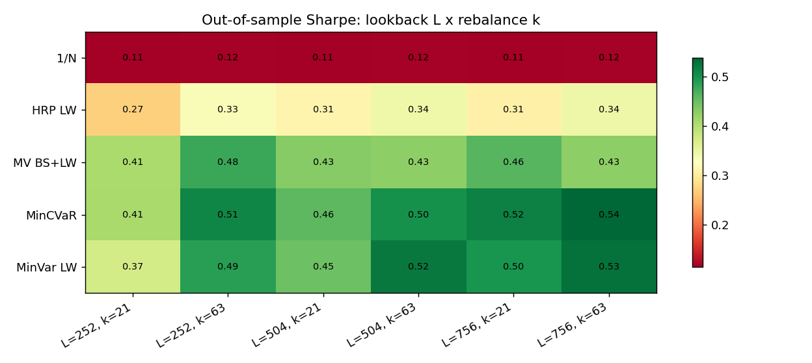
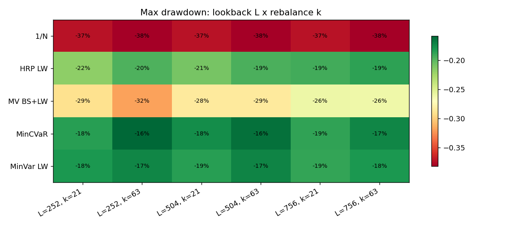
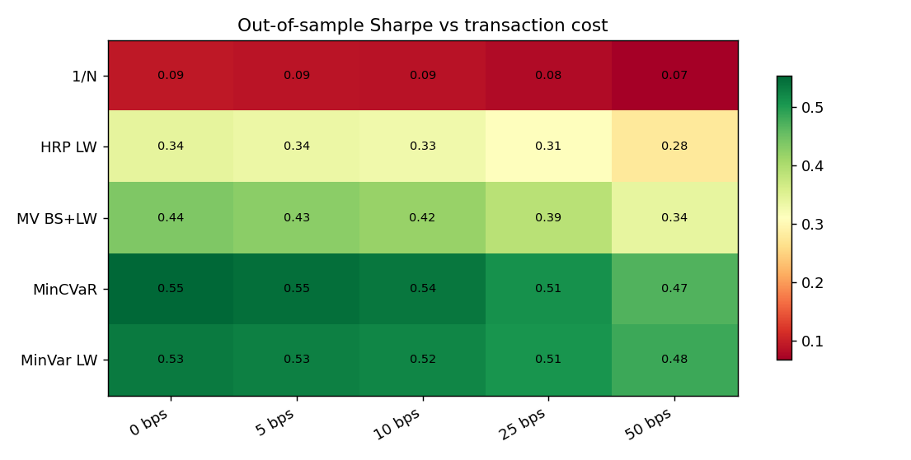
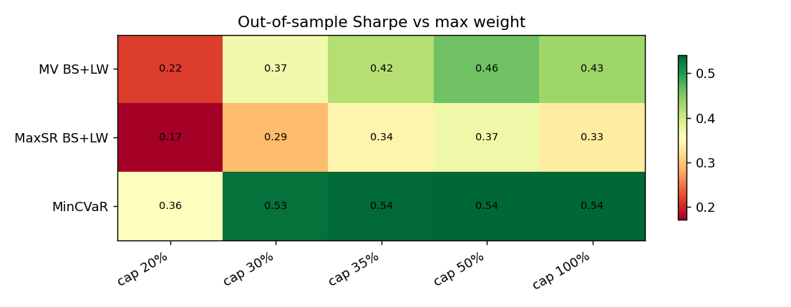
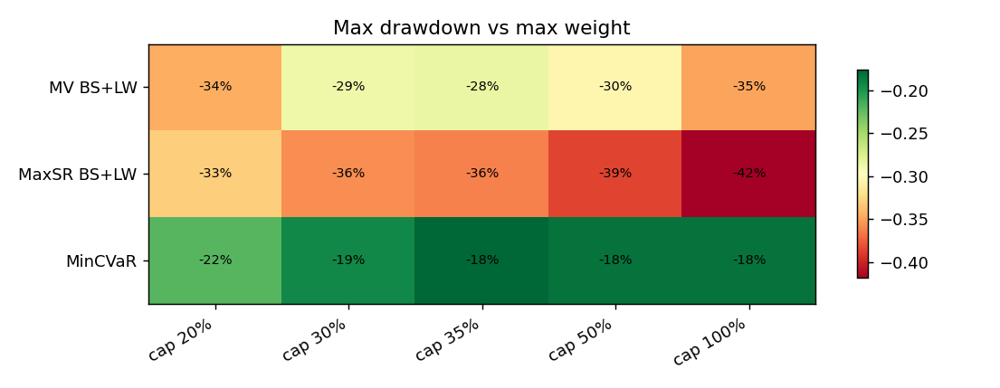
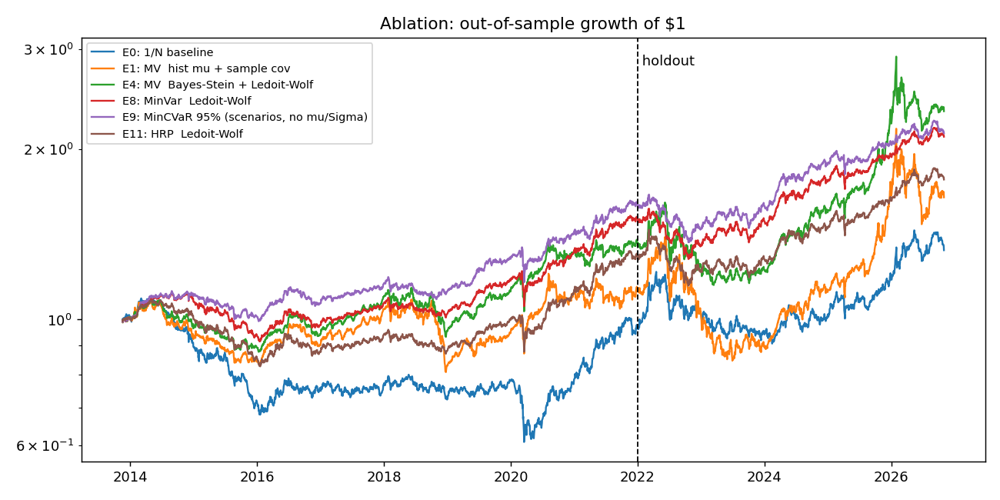

# Experiments

Universe: DBC, GLD, SLV, CPER, USO, UNG, DBA, CORN, WEAT, SPY, TLT. Daily data 2011-11-16 to 2026-10-30. Walk-forward: 504-day window, rebalance every 21 days, 10 bps costs, max weight 35%, gamma = 4. Data source: bundled snapshot.

## 1. Estimator ablation (full out-of-sample period)

Each row changes ONE ingredient. Pairs to compare: E1->E2 and E3->E4 (covariance shrinkage), E1->E3 and E2->E4 (mean shrinkage), E5->E6 (both, max Sharpe), E7->E8 and E10->E11 (covariance only, no mu needed).

| id | experiment | CAGR | Volatility | Sharpe | Sharpe CI low | Sharpe CI high | Max Drawdown | Turnover (ann.) | Avg effective N | p-value vs 1/N | p Holm vs 1/N | DSR |
|---|---|---|---|---|---|---|---|---|---|---|---|---|
| E0 | 1/N baseline | 0.022 | 0.125 | 0.087 | -0.437 | 0.613 | -0.447 | 0.630 | 11.000 |  |  | 0.266 |
| E1 | MV  hist mu + sample cov | 0.039 | 0.160 | 0.204 | -0.319 | 0.737 | -0.395 | 3.380 | 3.278 | 0.604 | 1.000 | 0.420 |
| E2 | MV  hist mu + Ledoit-Wolf | 0.037 | 0.161 | 0.191 | -0.332 | 0.725 | -0.395 | 3.337 | 3.303 | 0.642 | 1.000 | 0.403 |
| E3 | MV  Bayes-Stein + sample cov | 0.068 | 0.132 | 0.426 | -0.091 | 0.952 | -0.283 | 2.551 | 3.460 | 0.137 | 0.820 | 0.718 |
| E4 | MV  Bayes-Stein + Ledoit-Wolf | 0.068 | 0.133 | 0.418 | -0.098 | 0.948 | -0.285 | 2.565 | 3.551 | 0.143 | 0.820 | 0.709 |
| E5 | MaxSR  hist mu + sample cov | 0.056 | 0.124 | 0.353 | -0.146 | 0.852 | -0.341 | 2.537 | 3.453 | 0.234 | 0.935 | 0.628 |
| E6 | MaxSR  Bayes-Stein + Ledoit-Wolf | 0.054 | 0.120 | 0.343 | -0.148 | 0.834 | -0.362 | 2.493 | 3.655 | 0.250 | 0.935 | 0.615 |
| E7 | MinVar  sample cov | 0.067 | 0.078 | 0.630 | 0.100 | 1.160 | -0.183 | 0.760 | 4.152 | 0.013 | 0.148 | 0.906 |
| E8 | MinVar  Ledoit-Wolf | 0.059 | 0.080 | 0.524 | -0.004 | 1.042 | -0.185 | 0.808 | 4.815 | 0.028 | 0.279 | 0.827 |
| E9 | MinCVaR 95% (scenarios, no mu/Sigma) | 0.060 | 0.080 | 0.538 | 0.016 | 1.070 | -0.176 | 1.349 | 4.112 | 0.036 | 0.324 | 0.839 |
| E10 | HRP  sample cov | 0.053 | 0.086 | 0.420 | -0.087 | 0.936 | -0.206 | 1.176 | 6.303 | 0.041 | 0.328 | 0.716 |
| E11 | HRP  Ledoit-Wolf | 0.045 | 0.089 | 0.329 | -0.204 | 0.836 | -0.236 | 1.142 | 6.855 | 0.098 | 0.688 | 0.597 |

## 2. Untouched holdout (2022-01-01 onward)

Strategies are ranked on the selection period only (start to 2022-01-01); the holdout is never used for any choice. Best in selection: **E7** (MinVar  sample cov), holdout rank **4 of 12**. Spearman rank correlation selection vs holdout: **-0.05**.

| id | experiment | Sharpe (selection) | rank (selection) | Sharpe (holdout) | rank (holdout) | MaxDD (holdout) |
|---|---|---|---|---|---|---|
| E0 | 1/N baseline | -0.039 | 12.000 | 0.258 | 10.000 | -0.253 |
| E1 | MV  hist mu + sample cov | 0.126 | 10.000 | 0.293 | 6.000 | -0.395 |
| E2 | MV  hist mu + Ledoit-Wolf | 0.105 | 11.000 | 0.288 | 7.000 | -0.395 |
| E3 | MV  Bayes-Stein + sample cov | 0.414 | 7.000 | 0.483 | 2.000 | -0.283 |
| E4 | MV  Bayes-Stein + Ledoit-Wolf | 0.389 | 8.000 | 0.487 | 1.000 | -0.285 |
| E5 | MaxSR  hist mu + sample cov | 0.518 | 6.000 | 0.249 | 11.000 | -0.341 |
| E6 | MaxSR  Bayes-Stein + Ledoit-Wolf | 0.699 | 3.000 | 0.093 | 12.000 | -0.362 |
| E7 | MinVar  sample cov | 0.838 | 1.000 | 0.372 | 4.000 | -0.183 |
| E8 | MinVar  Ledoit-Wolf | 0.640 | 4.000 | 0.375 | 3.000 | -0.185 |
| E9 | MinCVaR 95% (scenarios, no mu/Sigma) | 0.750 | 2.000 | 0.268 | 9.000 | -0.176 |
| E10 | HRP  sample cov | 0.534 | 5.000 | 0.274 | 8.000 | -0.206 |
| E11 | HRP  Ledoit-Wolf | 0.349 | 9.000 | 0.305 | 5.000 | -0.203 |

## 3. Sensitivity

Window x rebalance (all evaluated from 2014-11-19 so the periods match):

|  | L=252, k=21 | L=252, k=63 | L=504, k=21 | L=504, k=63 | L=756, k=21 | L=756, k=63 |
|---|---|---|---|---|---|---|
| 1/N | 0.11 | 0.12 | 0.11 | 0.12 | 0.11 | 0.12 |
| HRP LW | 0.27 | 0.33 | 0.31 | 0.34 | 0.31 | 0.34 |
| MV BS+LW | 0.41 | 0.48 | 0.43 | 0.43 | 0.46 | 0.43 |
| MinCVaR | 0.41 | 0.51 | 0.46 | 0.50 | 0.52 | 0.54 |
| MinVar LW | 0.37 | 0.49 | 0.45 | 0.52 | 0.50 | 0.53 |

Transaction costs (bps per unit traded):

|  | 0 bps | 5 bps | 10 bps | 25 bps | 50 bps |
|---|---|---|---|---|---|
| 1/N | 0.09 | 0.09 | 0.09 | 0.08 | 0.07 |
| HRP LW | 0.34 | 0.34 | 0.33 | 0.31 | 0.28 |
| MV BS+LW | 0.44 | 0.43 | 0.42 | 0.39 | 0.34 |
| MinCVaR | 0.55 | 0.55 | 0.54 | 0.51 | 0.47 |
| MinVar LW | 0.53 | 0.53 | 0.52 | 0.51 | 0.48 |

Maximum weight per asset:

|  | cap 20% | cap 30% | cap 35% | cap 50% | cap 100% |
|---|---|---|---|---|---|
| MV BS+LW | 0.22 | 0.37 | 0.42 | 0.46 | 0.43 |
| MaxSR BS+LW | 0.17 | 0.29 | 0.34 | 0.37 | 0.33 |
| MinCVaR | 0.36 | 0.53 | 0.54 | 0.54 | 0.54 |

Min-CVaR confidence level:

|  | CAGR | Volatility | Sharpe | Max Drawdown | CVaR 95% (1d) |
|---|---|---|---|---|---|
| beta = 0.90 | 0.066 | 0.079 | 0.615 | -0.186 | 0.011 |
| beta = 0.95 | 0.060 | 0.080 | 0.538 | -0.176 | 0.012 |
| beta = 0.99 | 0.056 | 0.094 | 0.428 | -0.234 | 0.013 |

