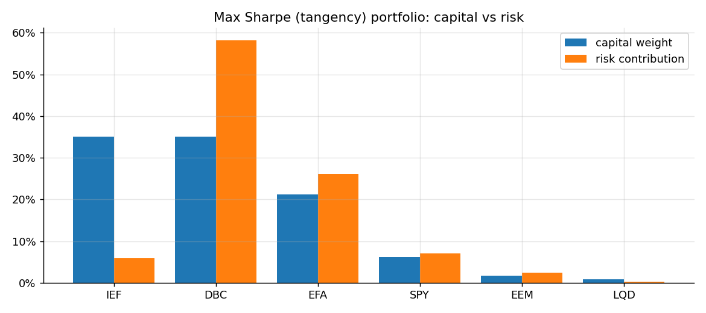
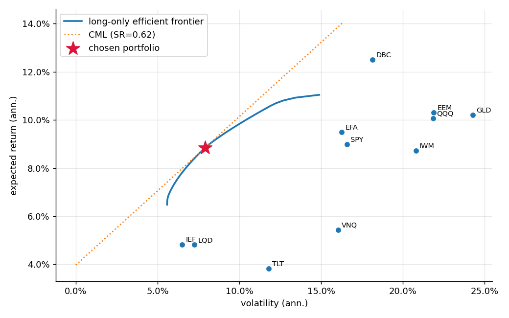
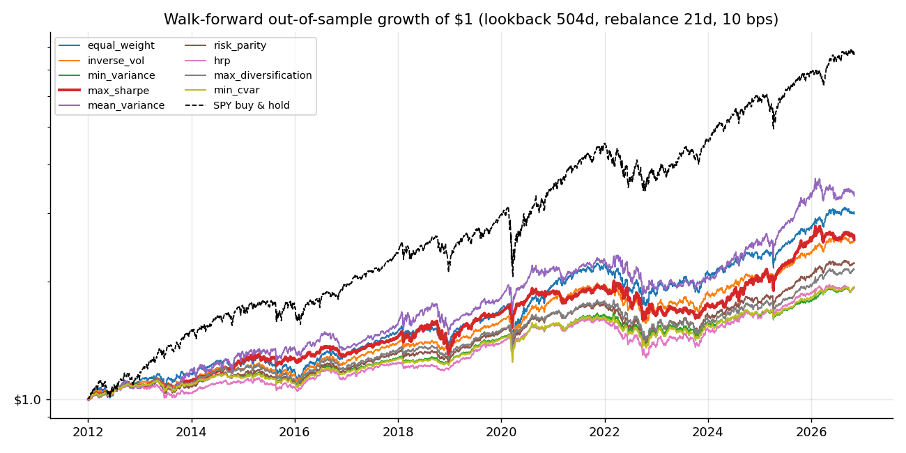
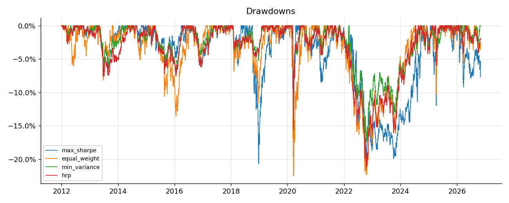
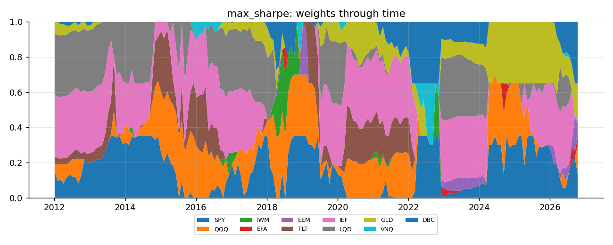
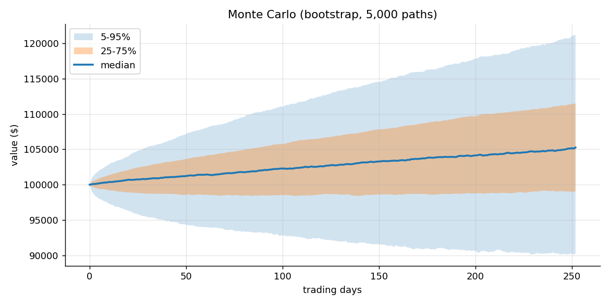
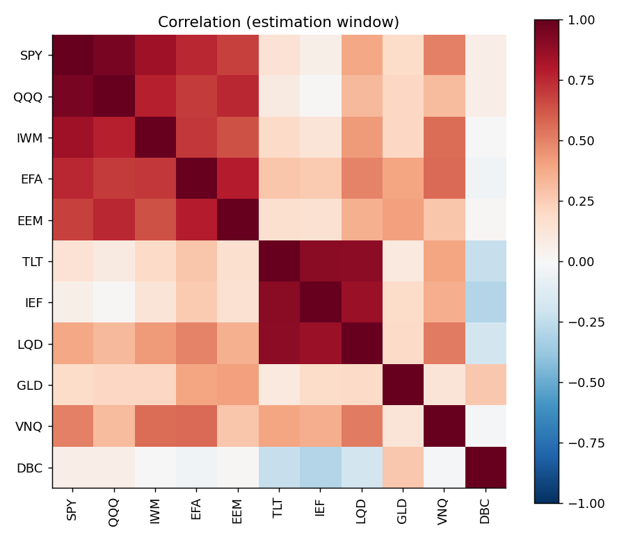

# Portfolio analysis - max_sharpe

Universe: SPY, QQQ, IWM, EFA, EEM, TLT, IEF, LQD, GLD, VNQ, DBC  |  data 2010-01-04 to 2026-10-30  |  mu: james_stein, Sigma: ledoit_wolf  |  risk appetite: moderate

> Yahoo unavailable/offline for DBC, EEM, EFA, GLD, IEF, IWM, LQD, QQQ, SPY, TLT, VNQ: using bundled snapshot (data ends 2026-10-30).

## Strategist brief - Max Sharpe (tangency) portfolio

**Allocation.** 6 of 11 assets held; largest positions IEF 35.0%, DBC 35.0%, EFA 21.2%, SPY 6.3%. Effective number of bets 1/HHI = 3.4, diversification ratio 1.71.

**Ex-ante profile.** Expected return 8.9%, volatility 7.9%, Sharpe 0.62 at rf = 3.97%. Expected returns are the noisiest input; treat the return figure as a shrunk estimate, not a forecast.

**Risk budget.** DBC carries 58.2% of portfolio volatility with 35.0% of capital - risk is more concentrated than capital.

**Tail risk.** 1-day 95% VaR 0.68% (historical) vs 0.75% (Gaussian): tails are close to Gaussian. Expected shortfall beyond VaR is 1.12% (about $1,116 on $100,000).

**Stress.** Worst replayed crisis: Global Financial Crisis at -27.9% (worst holding EFA -48.7%).

**Monte Carlo (bootstrap, 252 days).** Median value $105,254, 5th percentile $90,258, P(loss) 29%, P(drawdown > 20%) 2%.

**Out-of-sample evidence.** In the walk-forward backtest (costs 10 bps) this rule lagged 1/N on Sharpe (0.53 vs 0.61); the difference is NOT statistically significant after Holm correction for 8 comparisons (Jobson-Korkie-Memmel p = 0.657, Holm-adjusted 1.000). 95% block-bootstrap CI for its Sharpe: [0.08, 1.00]. Max drawdown -20.7%, annual turnover 2.9x. PSR = 0.98; Deflated Sharpe Ratio (adjusting for 9 strategies tried) = 0.95.

The best out-of-sample Sharpe among tested rules was **equal_weight** (0.61).

**Execution.** 4 trades, gross $97,082, estimated cost $97.

_Research/educational tool, not investment advice._

## Allocation

|  | exp. return | volatility | weight | pct_risk |
|---|---|---|---|---|
| SPY | 0.0898 | 0.1658 | 0.0626 | 0.0706 |
| QQQ | 0.1007 | 0.2183 | 0.0000 | 0.0000 |
| IWM | 0.0872 | 0.2078 | 0.0000 | 0.0000 |
| EFA | 0.0949 | 0.1626 | 0.2115 | 0.2611 |
| EEM | 0.1030 | 0.2188 | 0.0171 | 0.0240 |
| TLT | 0.0382 | 0.1180 | 0.0000 | 0.0000 |
| IEF | 0.0483 | 0.0650 | 0.3500 | 0.0594 |
| LQD | 0.0481 | 0.0725 | 0.0088 | 0.0024 |
| GLD | 0.1021 | 0.2427 | 0.0000 | 0.0000 |
| VNQ | 0.0543 | 0.1604 | 0.0000 | 0.0000 |
| DBC | 0.1250 | 0.1815 | 0.3500 | 0.5825 |

## Walk-forward backtest

|  | CAGR | Volatility | Sharpe | Sortino | Max Drawdown | Calmar | VaR 95% (1d) | CVaR 95% (1d) | Skewness | Excess Kurtosis | PSR (SR>0) | Beta | Sharpe CI low | Sharpe CI high | Turnover (ann.) | Avg effective N | JKM z vs 1/N | p-value vs 1/N | p Holm vs 1/N | DSR |
|---|---|---|---|---|---|---|---|---|---|---|---|---|---|---|---|---|---|---|---|---|
| equal_weight | 0.077 | 0.103 | 0.610 | 0.846 | -0.225 | 0.341 | 0.009 | 0.015 | -0.699 | 12.151 | 0.990 | 0.547 | 0.117 | 1.120 | 0.373 | 11.000 | nan | nan | nan | 0.975 |
| inverse_vol | 0.065 | 0.083 | 0.599 | 0.834 | -0.212 | 0.305 | 0.008 | 0.012 | -0.527 | 10.855 | 0.989 | 0.397 | 0.091 | 1.129 | 0.381 | 8.962 | -0.188 | 0.851 | 1.000 | 0.973 |
| min_variance | 0.046 | 0.061 | 0.487 | 0.681 | -0.174 | 0.262 | 0.006 | 0.009 | -0.340 | 9.480 | 0.969 | 0.174 | -0.031 | 0.979 | 0.571 | 3.785 | -0.669 | 0.504 | 1.000 | 0.934 |
| max_sharpe | 0.066 | 0.099 | 0.528 | 0.732 | -0.207 | 0.318 | 0.009 | 0.016 | -0.166 | 10.502 | 0.978 | 0.369 | 0.082 | 1.002 | 2.894 | 3.625 | -0.444 | 0.657 | 1.000 | 0.953 |
| mean_variance | 0.085 | 0.119 | 0.605 | 0.835 | -0.205 | 0.412 | 0.012 | 0.019 | -0.298 | 8.145 | 0.990 | 0.497 | 0.160 | 1.074 | 3.769 | 3.491 | -0.029 | 0.977 | 1.000 | 0.975 |
| risk_parity | 0.056 | 0.075 | 0.539 | 0.750 | -0.212 | 0.263 | 0.007 | 0.011 | -0.365 | 8.723 | 0.980 | 0.307 | 0.025 | 1.044 | 0.395 | 7.971 | -0.672 | 0.501 | 1.000 | 0.956 |
| hrp | 0.045 | 0.068 | 0.445 | 0.622 | -0.212 | 0.213 | 0.006 | 0.010 | -0.298 | 9.819 | 0.956 | 0.204 | -0.064 | 0.944 | 0.945 | 5.000 | -0.989 | 0.323 | 1.000 | 0.911 |
| max_diversification | 0.053 | 0.077 | 0.499 | 0.695 | -0.218 | 0.244 | 0.008 | 0.011 | -0.284 | 5.712 | 0.972 | 0.244 | 0.013 | 0.962 | 0.951 | 4.945 | -0.683 | 0.495 | 1.000 | 0.940 |
| min_cvar | 0.046 | 0.063 | 0.481 | 0.672 | -0.176 | 0.260 | 0.006 | 0.009 | -0.353 | 9.272 | 0.967 | 0.179 | -0.035 | 0.981 | 1.114 | 3.787 | -0.704 | 0.481 | 1.000 | 0.931 |
| SPY (buy & hold) | 0.147 | 0.165 | 0.817 | 1.153 | -0.337 | 0.437 | 0.015 | 0.025 | -0.311 | 14.567 | 0.999 | 1.000 | nan | nan | nan | nan | nan | nan | nan | nan |

## Stress tests

| scenario | start | end | portfolio return | worst asset | worst asset return | coverage |
|---|---|---|---|---|---|---|
| Global Financial Crisis | 2008-09-01 | 2009-03-09 | -0.279 | EFA | -0.487 | 1.000 |
| Euro debt crisis 2011 | 2011-07-22 | 2011-10-03 | -0.089 | EEM | -0.279 | 1.000 |
| Q4 2018 sell-off | 2018-09-20 | 2018-12-24 | -0.094 | SPY | -0.193 | 1.000 |
| COVID-19 crash | 2020-02-19 | 2020-03-23 | -0.164 | SPY | -0.337 | 1.000 |
| 2022 inflation / rate shock | 2022-01-03 | 2022-10-12 | -0.060 | EEM | -0.290 | 1.000 |

| market shock | portfolio beta | portfolio return | P&L |
|---|---|---|---|
| -0.1 | 0.267 | -0.027 | -2669.006 |
| -0.2 | 0.267 | -0.053 | -5338.013 |
| -0.3 | 0.267 | -0.080 | -8007.019 |
| -0.4 | 0.267 | -0.107 | -10676.026 |

## Trades

|  | price | current shares | current weight | target weight | drift | action | trade shares | trade value |
|---|---|---|---|---|---|---|---|---|
| DBC | 33.610 | 0.000 | 0.000 | 0.350 | 0.350 | BUY | 1041.000 | 34988.011 |
| EEM | 61.040 | 0.000 | 0.000 | 0.017 | 0.017 | HOLD | 0.000 | 0.000 |
| EFA | 103.370 | 0.000 | 0.000 | 0.212 | 0.212 | BUY | 204.000 | 21087.481 |
| GLD | 355.780 | 0.000 | 0.000 | 0.000 | 0.000 | HOLD | 0.000 | 0.000 |
| IEF | 91.760 | 0.000 | 0.000 | 0.350 | 0.350 | BUY | 381.000 | 34960.561 |
| IWM | 279.330 | 0.000 | 0.000 | 0.000 | 0.000 | HOLD | 0.000 | 0.000 |
| LQD | 104.270 | 0.000 | 0.000 | 0.009 | 0.009 | HOLD | 0.000 | 0.000 |
| QQQ | 690.490 | 0.000 | 0.000 | 0.000 | 0.000 | HOLD | 0.000 | 0.000 |
| SPY | 755.720 | 0.000 | 0.000 | 0.063 | 0.063 | BUY | 8.000 | 6045.760 |
| TLT | 81.840 | 0.000 | 0.000 | 0.000 | 0.000 | HOLD | 0.000 | 0.000 |
| VNQ | 93.940 | 0.000 | 0.000 | 0.000 | 0.000 | HOLD | 0.000 | 0.000 |

