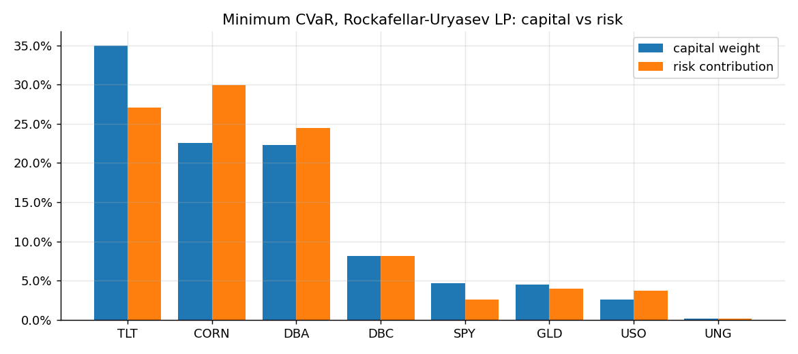
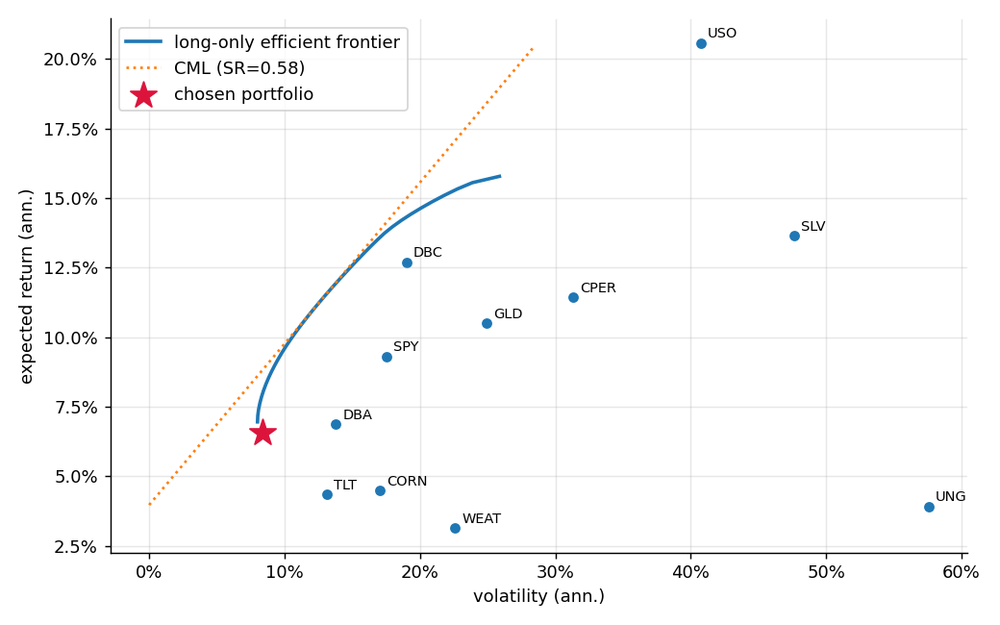
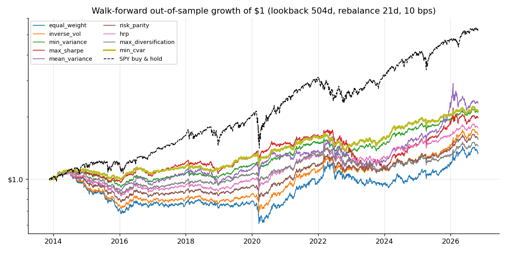
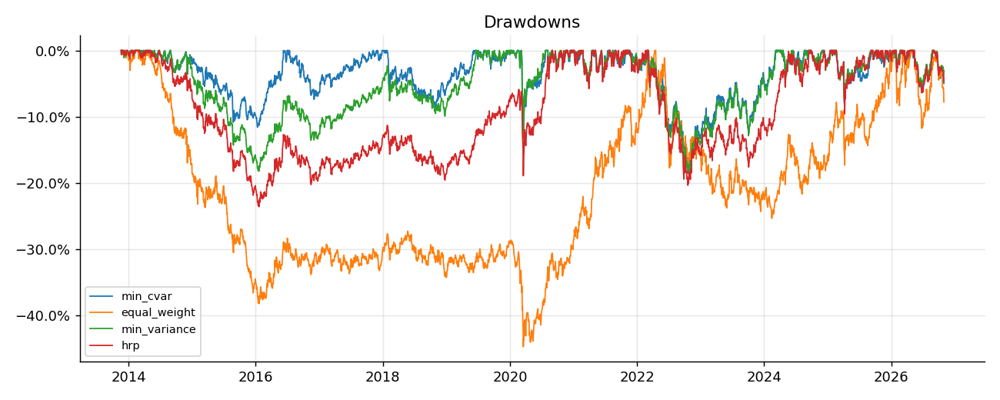
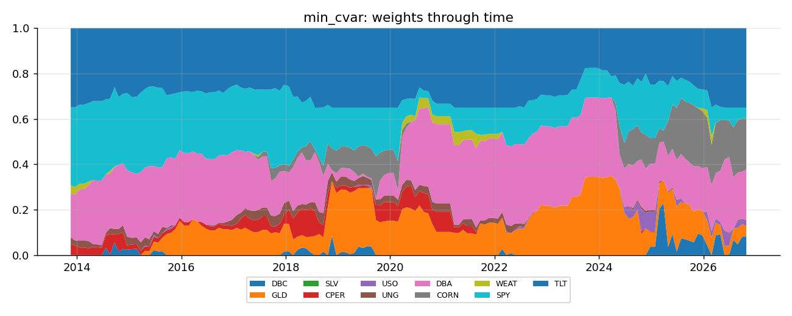
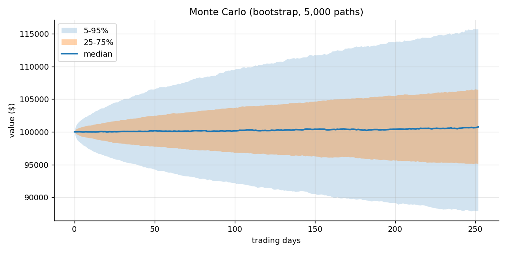
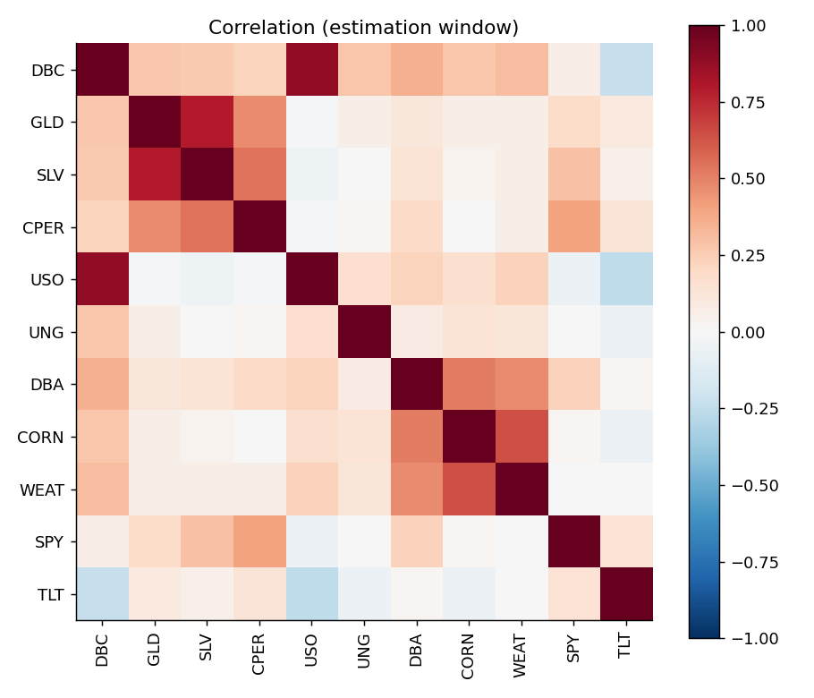

# Portfolio analysis - min_cvar

Universe: DBC, GLD, SLV, CPER, USO, UNG, DBA, CORN, WEAT, SPY, TLT  |  data 2011-11-15 to 2026-10-30  |  mu: james_stein, Sigma: ledoit_wolf  |  risk appetite: moderate

> Yahoo unavailable/offline for CORN, CPER, DBA, DBC, GLD, SLV, SPY, TLT, UNG, USO, WEAT: using bundled snapshot (data ends 2026-10-30).
> Common history starts 2011-11-15 (limited by CPER).

## Strategist brief - Minimum CVaR, Rockafellar-Uryasev LP

**Allocation.** 8 of 11 assets held; largest positions TLT 35.0%, CORN 22.5%, DBA 22.3%, DBC 8.2%. Effective number of bets 1/HHI = 4.3, diversification ratio 1.93.

**Ex-ante profile.** Expected return 6.6%, volatility 8.4%, Sharpe 0.31 at rf = 3.97%. Expected returns are the noisiest input; treat the return figure as a shrunk estimate, not a forecast.

**Risk budget.** CORN carries 29.9% of portfolio volatility with 22.5% of capital.

**Tail risk.** 1-day 95% VaR 0.79% (historical) vs 0.79% (Gaussian): tails are close to Gaussian. Expected shortfall beyond VaR is 1.03% (about $1,027 on $100,000).

**Stress.** Worst replayed crisis: Global Financial Crisis at -13.1% (worst holding USO -67.9%; only 77% of weight had data).

**Monte Carlo (bootstrap, 252 days).** Median value $100,743, 5th percentile $87,960, P(loss) 47%, P(drawdown > 20%) 1%.

**Out-of-sample evidence.** In the walk-forward backtest (costs 10 bps) this rule beat 1/N on Sharpe (0.54 vs 0.09); the difference is NOT statistically significant after Holm correction for 8 comparisons (Jobson-Korkie-Memmel p = 0.036, Holm-adjusted 0.252). 95% block-bootstrap CI for its Sharpe: [0.02, 1.07]. Max drawdown -17.6%, annual turnover 1.3x. PSR = 0.97; Deflated Sharpe Ratio (adjusting for 9 strategies tried) = 0.86.

**Execution.** 7 trades, gross $99,266, estimated cost $99.

_Research/educational tool, not investment advice._

## Allocation

|  | exp. return | volatility | weight | pct_risk |
|---|---|---|---|---|
| DBC | 0.1270 | 0.1901 | 0.0817 | 0.0818 |
| GLD | 0.1050 | 0.2489 | 0.0450 | 0.0396 |
| SLV | 0.1364 | 0.4763 | 0.0000 | 0.0000 |
| CPER | 0.1143 | 0.3128 | 0.0000 | 0.0000 |
| USO | 0.2058 | 0.4074 | 0.0260 | 0.0368 |
| UNG | 0.0393 | 0.5756 | 0.0019 | 0.0018 |
| DBA | 0.0687 | 0.1379 | 0.2229 | 0.2447 |
| CORN | 0.0450 | 0.1704 | 0.2254 | 0.2990 |
| WEAT | 0.0313 | 0.2259 | 0.0000 | 0.0000 |
| SPY | 0.0931 | 0.1753 | 0.0471 | 0.0258 |
| TLT | 0.0435 | 0.1313 | 0.3500 | 0.2705 |

## Walk-forward backtest

|  | CAGR | Volatility | Sharpe | Sortino | Max Drawdown | Calmar | VaR 95% (1d) | CVaR 95% (1d) | Skewness | Excess Kurtosis | PSR (SR>0) | Beta | Sharpe CI low | Sharpe CI high | Turnover (ann.) | Avg effective N | JKM z vs 1/N | p-value vs 1/N | p Holm vs 1/N | DSR |
|---|---|---|---|---|---|---|---|---|---|---|---|---|---|---|---|---|---|---|---|---|
| equal_weight | 0.022 | 0.125 | 0.087 | 0.121 | -0.447 | 0.049 | 0.012 | 0.018 | -0.264 | 3.119 | 0.623 | 0.272 | -0.437 | 0.613 | 0.630 | 11.000 | nan | nan | nan | 0.289 |
| inverse_vol | 0.039 | 0.107 | 0.234 | 0.327 | -0.366 | 0.106 | 0.010 | 0.016 | -0.249 | 2.953 | 0.800 | 0.248 | -0.298 | 0.759 | 0.601 | 9.835 | 2.098 | 0.036 | 0.252 | 0.490 |
| min_variance | 0.059 | 0.080 | 0.524 | 0.738 | -0.185 | 0.319 | 0.008 | 0.012 | -0.186 | 4.928 | 0.970 | 0.211 | -0.004 | 1.042 | 0.808 | 4.815 | 2.199 | 0.028 | 0.223 | 0.844 |
| max_sharpe | 0.054 | 0.120 | 0.343 | 0.456 | -0.362 | 0.150 | 0.011 | 0.019 | -1.492 | 20.587 | 0.887 | 0.286 | -0.148 | 0.834 | 2.493 | 3.655 | 1.150 | 0.250 | 0.571 | 0.640 |
| mean_variance | 0.068 | 0.133 | 0.418 | 0.552 | -0.285 | 0.238 | 0.012 | 0.021 | -2.056 | 30.308 | 0.928 | 0.305 | -0.098 | 0.948 | 2.565 | 3.551 | 1.466 | 0.143 | 0.571 | 0.731 |
| risk_parity | 0.035 | 0.098 | 0.208 | 0.291 | -0.290 | 0.121 | 0.010 | 0.014 | -0.190 | 3.154 | 0.773 | 0.226 | -0.306 | 0.724 | 0.639 | 8.745 | 1.454 | 0.146 | 0.571 | 0.452 |
| hrp | 0.045 | 0.089 | 0.329 | 0.465 | -0.236 | 0.191 | 0.009 | 0.013 | -0.094 | 3.226 | 0.881 | 0.213 | -0.204 | 0.836 | 1.142 | 6.855 | 1.653 | 0.098 | 0.491 | 0.623 |
| max_diversification | 0.029 | 0.095 | 0.150 | 0.209 | -0.243 | 0.119 | 0.009 | 0.014 | -0.193 | 4.559 | 0.705 | 0.229 | -0.353 | 0.651 | 0.898 | 5.969 | 0.485 | 0.627 | 0.627 | 0.372 |
| min_cvar | 0.060 | 0.080 | 0.538 | 0.755 | -0.176 | 0.342 | 0.008 | 0.012 | -0.297 | 4.802 | 0.973 | 0.192 | 0.016 | 1.070 | 1.349 | 4.112 | 2.096 | 0.036 | 0.252 | 0.855 |
| SPY (buy & hold) | 0.137 | 0.170 | 0.728 | 1.022 | -0.337 | 0.405 | 0.016 | 0.026 | -0.311 | 14.505 | 0.995 | 1.000 | nan | nan | nan | nan | nan | nan | nan | nan |

## Stress tests

| scenario | start | end | portfolio return | worst asset | worst asset return | coverage |
|---|---|---|---|---|---|---|
| Global Financial Crisis | 2008-09-01 | 2009-03-09 | -0.131 | USO | -0.679 | 0.775 |
| Euro debt crisis 2011 | 2011-07-22 | 2011-10-03 | 0.028 | USO | -0.236 | 1.000 |
| Q4 2018 sell-off | 2018-09-20 | 2018-12-24 | -0.007 | USO | -0.372 | 1.000 |
| COVID-19 crash | 2020-02-19 | 2020-03-23 | -0.047 | USO | -0.564 | 1.000 |
| 2022 inflation / rate shock | 2022-01-03 | 2022-10-12 | -0.020 | TLT | -0.293 | 1.000 |

| market shock | portfolio beta | portfolio return | P&L |
|---|---|---|---|
| -0.1 | 0.139 | -0.014 | -1394.182 |
| -0.2 | 0.139 | -0.028 | -2788.365 |
| -0.3 | 0.139 | -0.042 | -4182.547 |
| -0.4 | 0.139 | -0.056 | -5576.730 |

## Trades

|  | price | current shares | current weight | target weight | drift | action | trade shares | trade value |
|---|---|---|---|---|---|---|---|---|
| CORN | 17.340 | 0.000 | 0.000 | 0.225 | 0.225 | BUY | 1299.000 | 22524.660 |
| CPER | 38.990 | 0.000 | 0.000 | 0.000 | 0.000 | HOLD | 0.000 | 0.000 |
| DBA | 26.890 | 0.000 | 0.000 | 0.223 | 0.223 | BUY | 829.000 | 22291.809 |
| DBC | 33.610 | 0.000 | 0.000 | 0.082 | 0.082 | BUY | 243.000 | 8167.230 |
| GLD | 355.780 | 0.000 | 0.000 | 0.045 | 0.045 | BUY | 12.000 | 4269.360 |
| SLV | 44.600 | 0.000 | 0.000 | 0.000 | 0.000 | HOLD | 0.000 | 0.000 |
| SPY | 755.720 | 0.000 | 0.000 | 0.047 | 0.047 | BUY | 6.000 | 4534.320 |
| TLT | 81.840 | 0.000 | 0.000 | 0.350 | 0.350 | BUY | 427.000 | 34945.678 |
| UNG | 9.080 | 0.000 | 0.000 | 0.002 | 0.002 | HOLD | 0.000 | 0.000 |
| USO | 168.830 | 0.000 | 0.000 | 0.026 | 0.026 | BUY | 15.000 | 2532.450 |
| WEAT | 22.200 | 0.000 | 0.000 | 0.000 | 0.000 | HOLD | 0.000 | 0.000 |

